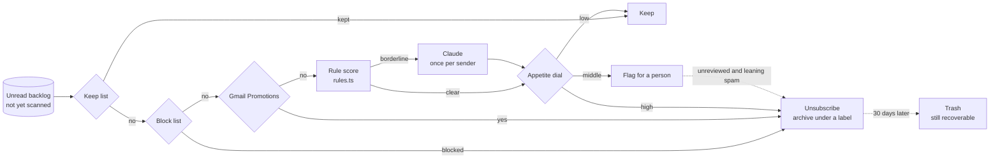

# inbox-agent

An inbox agent built so it never has to be trusted: rules decide first, Claude only sees what the rules cannot settle, and anything unsure is flagged for a person instead of acted on.

This is the decision engine behind [Snailmail](https://getsnailmail.app), an iPhone email app [on the App Store](https://apps.apple.com/app/id6825403744) where a sidekick called Gary works through years of unread mail, rewritten here as a standalone TypeScript module with a fictional mailbox (Maya Torres, every sender under `.example`) so the design can be read in public. The production system is private and written in Python; its numbers are below.

## The idea

People sign up because their inbox has thousands of unread messages and they have stopped looking. The job is to get rid of the bulk mail in that backlog, unsubscribe from what keeps coming, and never lose the bank alert, the receipt or the note from a friend sitting in the same pile.

The obvious build is to hand each message to a model and do what it says. That puts the most expensive mistake, eating mail the user wanted, in the hands of the least predictable component, on every message, at a cost that grows with the backlog. So the agent is built in layers, cheapest and most certain first, and every change it makes to the mailbox is one a person can undo:

| Decision | Made by | Why |
|---|---|---|
| Did the user keep this sender? | Rules: the Keep list, checked before anything else | The one control the user has must always win |
| Did the user block this sender? | Rules: the Block list, subdomains included | The user already decided |
| Is it bulk commercial mail? | Gmail's own Promotions category | Google has already classified it, for free; this settles over half of the decisions on file |
| How much does it look like bulk mail? | Rules: list headers, bulk sender addresses, tracking pixels, keywords, sending frequency | Free, instant, explainable, and decisive for most of what is left |
| The rules are unsure (score 0.3 to 0.7) | Claude, cached once per sender domain, weighed as half the score | Judgment helps here, and only here; it never acts alone |
| Does the user read this sender? | Rules: two or more opened in 90 days dampens the score | Behavior is better evidence than content |
| Eat it, flag it, or keep it? | The user's appetite dial | One setting moves every line, and never touches the lists |
| A flag nobody reviewed for 30 days | Rules: resolved as a Block only if it scored within 0.1 of the dial | Closes the loop for people who never open the queue; the least certain flags stay put |
| When does eaten mail leave for good? | Rules: Trash, 30 days after Gary acted | Undo stays possible for a month, then another month in Gmail's Trash |



## The production system

Snailmail is a native iPhone email app, live on the App Store since November 15, 2026. The inbox is free; Gary is $2.99 a month. Behind it are FastAPI, Supabase Postgres, APScheduler and Railway, plus a way to drive Gary from inside Gmail by moving a message into a Gary-Keep or Gary-Block label. It passed Google's OAuth verification for restricted Gmail scopes and a CASA Tier 2 security assessment.

**Production went one step further in November: Gary no longer acts on his own.** With a fast swipe-to-review screen in the app, a person deciding became cheap, so everything Gary deems unwanted is now flagged for review, and only senders the user blocked are cleared automatically. This module still models the full dial, which is how production ran for its first 720,000 messages.

By November 24, 2026, the engine had processed 731,226 messages across 40,525 runs, for 29 connected Gmail accounts. The breakdown below is from October 7, 2026, before that change:

- 24 people have connected Gmail; 22 connections are active
- 29,442 completed engine runs since February 24, 2026: 9,966 in Deep Clean and 19,476 in Maintain
- 720,290 messages processed: 412,737 eaten, 138,522 flagged for a person, 150,442 kept; the other 18,592 were errors (11,192), bounces from Gary's own unsubscribes, or held over to the next run by the per run cap
- Of the 497,595 decisions still on file, 62.7 percent were settled by a short circuit rule before any scoring: Gmail Promotions 281,378, the user's Keep list 28,670, the Block list 1,944. The other 185,603 were scored, and only the borderline ones among those can reach Claude.
- Users reversed 33 of the 281,378 Promotions decisions on file by pressing Keep
- At least 117,151 eaten messages moved to Trash by the 30 day sweep; none of them were kept, skipped or pending mail
- 22 of 24 users are on the Balanced setting of the dial; one is on Hungry, one on Picky

Production calls Claude Haiku 4.5 (`claude-haiku-4-5-20251001`) with a short prompt and parses JSON out of the text reply, and only when the server has an API key configured. This version uses structured outputs through the official SDK, so a malformed answer cannot reach the score, and defaults to `claude-opus-5-5`; set `INBOX_AGENT_MODEL` to change it. Production keeps decisions for messages Gmail has since purged only as counts, which is why the decision total above is lower than the run total.

## Run it

```bash
npm install
npm run demo                    # rules only, no network, no key
npm run demo -- --with-claude   # borderline mail goes to Claude; needs ANTHROPIC_API_KEY
npm test                        # 39 tests, including the schema against real Postgres (PGlite)
```

A month of Maya's mailbox on a fake clock, rules only:

```
Maya's inbox: 12 unread, the oldest from Nov 2 2025. Appetite: Balanced (eat at 0.5, flag at 0.3). Model: none.

Run 1  Oct 7, 14:00  Deep Clean, oldest first, 12 unread unscanned
  m01  EAT   Tidewater Outfitters        promotions: Gmail filed it under Promotions (with List-Unsubscribe)
  m02  EAT   BrightCart                  block list: you blocked brightcart.example
  m03  keep  Lantern Books               keep list: you kept news@lanternbooks.example
  m04  keep  Harbor Bank                 score 0.07 (rules 0.07; rules alone, model not needed)
  m05  keep  Jordan Lee                  score 0.00 (rules 0.00; rules alone, model not needed)
  m06  keep  Copper Kettle               score 0.17 (rules 0.17; rules alone, model not needed)
  m07  FLAG  The Ledger Daily            score 0.48 (rules 0.48; borderline, no model: rules decide)
  m08  FLAG  Riverside Community Garden  score 0.34 (rules 0.34; borderline, no model: rules decide)
  m09  keep  Field Notes                 score 0.25 (rules 0.41; borderline, no model: rules decide, dampened: she reads this sender)
  m10  FLAG  Dan Price                   score 0.41 (rules 0.41; borderline, no model: rules decide)
  m11  FLAG  Dan Price                   score 0.41 (rules 0.41; borderline, no model: rules decide)
  m12  FLAG  Dan Price                   score 0.41 (rules 0.41; borderline, no model: rules decide)
  next run Oct 7, 14:30.

Run 2  Oct 7, 14:30  Deep Clean, oldest first, 0 unread unscanned
  nothing to do: every message already carries Gary-Scanned
  next run Oct 7, 18:30.  Switched to Maintain.

Maya opens her review queue  Oct 8, 09:00
  Block growthloop.example   m10, m11, m12 archived under Gary-Unsubscribed
  Keep tidewater.example     m01 moved back to the inbox: Gary had only archived it
  left for later             m07, m08

Run 3  Oct 8, 16:30  Maintain, newest first, 2 unread unscanned
  m14  keep  Jordan Lee                  score 0.00 (rules 0.00; rules alone, model not needed)
  m13  keep  Tidewater Outfitters        keep list: you kept offers@tidewater.example
  next run Oct 8, 18:30.

Run 4  Nov 8, 16:00  Maintain, newest first, 0 unread unscanned
  m07  BLOCK  flag unreviewed for 30 days, score 0.48 over the stale line 0.4
  to Trash, 30 days after Gary ate them: m02, m10, m11, m12
  next run Nov 8, 20:00.

A month on: 4 in Trash (recoverable), 1 archived under Gary-Unsubscribed, 11 in the inbox (1 of them waiting for Maya), 0 deleted.

The appetite dial, on the same scores
                                  score  picky 0.7     careful 0.6   balanced 0.5  hungry 0.4    ravenous 0.3
  m02  BrightCart                   -    eat           eat           eat           eat           eat
  m03  Lantern Books                -    keep          keep          keep          keep          keep
  m07  The Ledger Daily           0.48   keep          flag          flag          eat           eat
  m10  Dan Price                  0.41   keep          flag          flag          eat           eat
  m08  Riverside Community Garden 0.34   keep          keep          flag          flag          eat
  m09  Field Notes                0.25   keep          keep          keep          flag          flag
```

With `--with-claude`, Claude is asked four times in Run 1, about the four borderline senders (m07, m08, m09, m10) and nothing else. The sales sequence costs one call, not three: m11 and m12 reuse the verdict cached for growthloop.example. That output is not shown because it depends on the model.

## What's where

| | |
|---|---|
| [src/rules.ts](src/rules.ts) | The deterministic layers: Keep, Block, Promotions, keywords, frequency, marketing shape, and their weights |
| [src/detector.ts](src/detector.ts) | One message to one decision: layer order, the borderline band, the per sender model cache, the dial |
| [src/classifier.ts](src/classifier.ts) | Claude via structured outputs, behind an interface the agent runs without |
| [src/appetite.ts](src/appetite.ts) | The dial: one number, three lines |
| [src/engine.ts](src/engine.ts) | One scheduled run: Deep Clean and Maintain, batch sizes, the per run cap, idempotency, the 30 day sweeps |
| [src/controls.ts](src/controls.ts) | Keep and Block, domain wide, each clearing the other, Keep undoing an eat |
| [src/mailbox.ts](src/mailbox.ts) | The Gmail surface the agent uses, and an in-memory `FakeMailbox` |
| [src/unsubscribe.ts](src/unsubscribe.ts) | The unsubscribe interface and a stub; what production tries, and in what order |
| [schema/001_inbox.sql](schema/001_inbox.sql) | Postgres: production's tables and row level security, one decision per message |
| [test/](test/) | The layers and the dial, the model seam with a stubbed client, the engine on a fake clock, the schema as an ordinary database role |

## Choices worth defending

- **Keep is checked before Block.** In production it once ran the other way round, and a domain that was on both lists was eaten even though the user had pressed Keep. Real users lost 527 messages they had rescued by hand. Now both lists are written only by the user, each button clears the other, and the Keep list runs first.
- **The model sees only what the rules cannot settle.** Mail scoring under 0.3 or over 0.7 never reaches it, and a sender is classified once and cached for 30 days. Cost follows new senders, not volume, and a backlog of thousands does not mean thousands of calls.
- **The model is one input, not the decision.** Its answer is half of a weighted score that still has to clear the user's dial. On Picky, the same "unwanted, 90 percent" that eats a newsletter on Balanced only flags it. A refusal, an error or no key leaves the rules to decide.
- **The model is shown less than the rules read.** Claude gets the sender, subject, Gmail's preview text and two header facts, never the body. The keyword and marketing rules do read the top of the body, locally.
- **Nothing the agent does to the mailbox is permanent.** Eating a message means archiving it under Gary-Unsubscribed; Keep moves it back. Thirty days after Gary acted, not after the mail was sent, it moves to Trash, which Gmail keeps for another thirty. There is no delete call in the agent's interface. The one shortcut: bounces caused by Gary's own mailto unsubscribes go straight to Trash, and mailto unsubscribes are off by default.
- **Unsure has a place to go.** The flag band sits between keep and eat on every setting of the dial, and a flagged message is not touched.
- **Unreviewed flags do not wait forever, but only the confident ones move.** After 30 days a flag that scored within 0.1 of the dial is treated as a Block. Anything lower stays in the queue until a person decides. This is the one place the agent acts on mail it was unsure about, so it is bounded twice: by score and by time, and the result is still an archive, not a deletion.
- **Every run is safe to repeat.** Each processed message is labeled Gary-Scanned and the backlog query excludes the label; decisions are upserted on (user, message). One run can eat at most 50 in Deep Clean and 25 in Maintain, so a bad rule or a bad dial costs one batch before someone notices.
- **Oldest first.** Gmail lists newest first, so a naive loop clears this week's mail and never reaches the backlog people signed up to get rid of. Deep Clean pages to the end of the list instead.

## Known gaps

Both are production behavior, reproduced here so the tests describe the real system.

- A message that scores over the dial, or comes from a blocked sender, but has no working unsubscribe endpoint is left in the inbox, labeled scanned, with no decision row. It errs toward keeping, but the user is never told. Promotions mail is archived either way.
- Keep restores the message it was pressed on. Earlier mail Gary ate from the same sender stays under the label until the Trash sweep, still recoverable but not brought back.

Built by [Jeffrey Mailey](https://github.com/jmailey23), [Jump Automations](https://jumpautomations.com).
